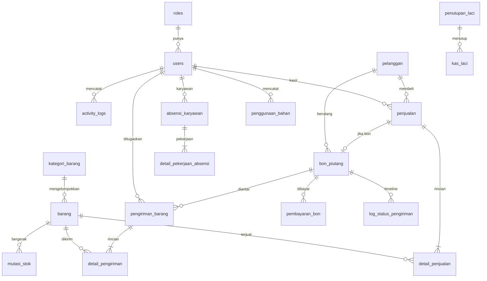

# PASKA JAYA — Database Schema (v1, versi sederhana)

> Sumber: laporan MSBD Kelompok 7 (14 entitas inti, §2.3) **dilengkapi** 8 tabel pendukung agar semua layar di PDF desain terlayani.
> DBMS: **MySQL 8** (Laragon). Charset `utf8mb4` (default MySQL 8; script SQL tidak menetapkan collation eksplisit). Penamaan tabel/kolom: **snake_case Bahasa Indonesia** (sesuai laporan).
> **Versi sederhana** (`01_tabel_sederhana.sql`): 22 tabel, **tanpa `CHECK`, tanpa kolom virtual, tanpa `ON UPDATE`**. Pengecekan (stok tidak minus, jumlah > 0, dll.) dilakukan oleh **trigger**.
> **Database dibuat KOSONG. Tidak ada seeder/data dummy** (ADR-012). Semua data berasal dari tim PASKA JAYA lewat aplikasi.

## Ringkasan
| # | Tabel | Asal | Fungsi |
|---|---|---|---|
| 1 | `roles` | Laporan | Peran: admin, owner, kasir, karyawan |
| 2 | `users` | Laporan | Semua pengguna sistem |
| 3 | `system_configs` | Laporan | Konfigurasi (auto backup, jam reset laci, dll.) |
| 4 | `activity_logs` | Laporan | Audit aktivitas pengguna (append-only) |
| 5 | `kategori_barang` | Laporan | Pengelompokan barang (filter otomatis) |
| 6 | `barang` | Laporan | Master item + stok + harga |
| 7 | `penggunaan_bahan` | Laporan | Bahan harian (pengeluaran operasional) |
| 8 | `pelanggan` | Laporan | Data pelanggan (penjualan & bon) |
| 9 | `penjualan` | Laporan | Header transaksi (langsung / bon) |
| 10 | `detail_penjualan` | Laporan | Rincian item transaksi |
| 11 | `bon_piutang` | Laporan | Piutang pelanggan (1:1 dengan penjualan bertipe bon) |
| 12 | `pengiriman_barang` | Laporan | Tugas pengiriman oleh karyawan + foto bukti |
| 13 | `detail_pengiriman` | Laporan | Rincian barang yang dikirim |
| 14 | `absensi_karyawan` | Laporan | Kehadiran harian + shift |
| 15 | `detail_pekerjaan_absensi` | **Tambahan** | Daftar pekerjaan per absensi (1NF; menggantikan kolom array) |
| 16 | `mutasi_stok` | **Tambahan** | Jejak keluar-masuk stok (anti stock discrepancy) |
| 17 | `pembayaran_bon` | **Tambahan** | Riwayat cicilan/pelunasan bon |
| 18 | `log_status_pengiriman` | **Tambahan** | Timeline "Alur Status" bon + jam |
| 19 | `kas_laci` | **Tambahan** | Uang masuk ke laci (cash/transfer) |
| 20 | `penutupan_laci` | **Tambahan** | Riwayat reset laci (otomatis 00:00 / manual) |
| 21 | `anggota_tim` | **Tambahan** | Halaman Tim (admin) |
| 22 | `otp_codes` | **Tambahan** | Verifikasi OTP register |

Tabel bawaan Laravel (otomatis): `password_reset_tokens`, `sessions`, `cache`, `jobs`, `migrations`.

## ERD Overview (Mermaid)

## Detail Tabel
Tipe uang: `BIGINT` (rupiah utuh, ADR-003). Semua PK/FK memakai `INT` (`AUTO_INCREMENT`). Tidak ada tipe `UNSIGNED` — nilai tidak boleh negatif dijaga trigger/aplikasi.
Hanya tabel yang tercantum punya `created_at`; **tidak ada kolom `updated_at`** (kecuali `system_configs`, tanpa `ON UPDATE` otomatis — aplikasi mengisinya saat ubah).
Aksi FK yang tidak disebut `SET NULL`/`CASCADE` berarti `RESTRICT` (perilaku default MySQL; tidak ada `ON UPDATE`).
Tidak ada index eksplisit selain `PRIMARY KEY`, `UNIQUE`, dan index otomatis dari FK.

### 1. roles
| Kolom | Tipe | Constraint | Deskripsi |
|---|---|---|---|
| id | INT | PK, AI | |
| nama | VARCHAR(30) | UNIQUE, NOT NULL | `admin`, `owner`, `kasir`, `karyawan` |
| label | VARCHAR(50) | NOT NULL | Admin, Owner, Kasir, Karyawan |
| deskripsi | VARCHAR(255) | NULL | |
> Isi tabel `roles` adalah **data referensi sistem** (4 baris, dibuat oleh migration, bukan data dummy).

### 2. users
| Kolom | Tipe | Constraint | Deskripsi |
|---|---|---|---|
| id | INT | PK | |
| role_id | INT | FK roles RESTRICT | |
| nama | VARCHAR(100) | NOT NULL | |
| email | VARCHAR(150) | UNIQUE, NOT NULL | |
| no_hp | VARCHAR(20) | UNIQUE, NULL | login boleh pakai email atau no_hp |
| password | VARCHAR(255) | NOT NULL | hash bcrypt/argon |
| status | ENUM('aktif','nonaktif') | DEFAULT 'aktif' | nonaktif = tidak bisa login |
| alamat | TEXT | NULL | |
| foto_profil | VARCHAR(255) | NULL | disk `public` |
| email_verified_at | TIMESTAMP | NULL | |
| remember_token | VARCHAR(100) | NULL | |
| created_at | TIMESTAMP | DEFAULT CURRENT_TIMESTAMP | |
| deleted_at | TIMESTAMP | NULL | soft delete |

### 3. system_configs
| Kolom | Tipe | Constraint | Deskripsi |
|---|---|---|---|
| id | INT | PK | |
| kunci | VARCHAR(100) | UNIQUE, NOT NULL | `auto_backup`, `jam_backup`, `backup_terakhir`, `jam_reset_laci`, `sinkronisasi_data`, `nama_toko` |
| nilai | TEXT | NOT NULL | |
| deskripsi | VARCHAR(255) | NULL | |
| updated_by | INT | FK users SET NULL, NULL | |
| updated_at | TIMESTAMP | DEFAULT CURRENT_TIMESTAMP | tanpa `ON UPDATE` — aplikasi mengisi saat ubah |
> Nilai default (mis. `jam_backup=02:00`, `jam_reset_laci=00:00`) dibuat migration sebagai konfigurasi sistem, bukan data transaksi.

### 4. activity_logs (append-only — trigger T8)
| Kolom | Tipe | Constraint | Deskripsi |
|---|---|---|---|
| id | INT | PK | |
| user_id | INT | FK users SET NULL | |
| aksi | VARCHAR(50) | NOT NULL | login, logout, tambah, ubah, hapus, kirim_bon, bayar_bon, reset_laci |
| modul | VARCHAR(50) | NOT NULL | barang, penjualan, bon, pengguna, … |
| target_id | INT | NULL | |
| deskripsi | VARCHAR(255) | NOT NULL | |
| data_lama / data_baru | JSON | NULL | untuk perubahan harga/stok/role |
| ip_address | VARCHAR(45) | NULL | |
| user_agent | VARCHAR(255) | NULL | |
| created_at | TIMESTAMP | DEFAULT CURRENT_TIMESTAMP | (tanpa updated_at) |

### 5. kategori_barang
| Kolom | Tipe | Constraint | Deskripsi |
|---|---|---|---|
| id | INT | PK | |
| nama | VARCHAR(80) | UNIQUE | mis. Semen, Pasir & Batu, Cat (diinput tim) |
| slug | VARCHAR(100) | UNIQUE, NULL | diisi otomatis (trigger) |
| created_at | TIMESTAMP | DEFAULT CURRENT_TIMESTAMP | |
> Kategori dibuat otomatis saat pengguna mengetik kategori baru di form barang (ADR-010).

### 6. barang
| Kolom | Tipe | Constraint | Deskripsi |
|---|---|---|---|
| id | INT | PK | |
| kode_barang | VARCHAR(20) | UNIQUE | otomatis `BRG-001` (trigger; bisa diedit) |
| kategori_id | INT | FK kategori_barang RESTRICT | |
| nama_barang | VARCHAR(150) | NOT NULL | |
| satuan | VARCHAR(30) | NOT NULL | Sak, Batang, Dus, M³, … |
| harga_beli | BIGINT | NOT NULL | dasar "Nilai Stok" |
| harga_jual | BIGINT | NOT NULL | |
| stok | INT | NOT NULL, DEFAULT 0 | tidak boleh minus — dijaga trigger T1 |
| stok_minimum | INT | NOT NULL, DEFAULT 10 | batas stok menipis |
| foto | VARCHAR(255) | NULL | |
| tanggal_masuk_terakhir | DATE | NULL | kolom "Tanggal Masuk" |
| created_at | TIMESTAMP | DEFAULT CURRENT_TIMESTAMP | |
| deleted_at | TIMESTAMP | NULL | |

### 7. penggunaan_bahan (halaman Bahan Harian)
| Kolom | Tipe | Constraint | Deskripsi |
|---|---|---|---|
| id | INT | PK | |
| tanggal | DATE | NOT NULL | |
| nama_bahan | VARCHAR(150) | NOT NULL | mis. bensin pick-up |
| jumlah | DECIMAL(10,2) | NOT NULL | harus > 0 (dijaga aplikasi/trigger) |
| satuan | VARCHAR(30) | NOT NULL | liter, pasang, galon, … |
| harga | BIGINT | NOT NULL | total rupiah |
| keterangan | VARCHAR(255) | NULL | |
| user_id | INT | FK users | pencatat (kasir) |
| created_at | TIMESTAMP | DEFAULT CURRENT_TIMESTAMP | |

### 8. pelanggan
| Kolom | Tipe | Constraint | Deskripsi |
|---|---|---|---|
| id | INT | PK | |
| nama | VARCHAR(120) | NOT NULL | |
| no_hp | VARCHAR(20) | NULL | |
| alamat | TEXT | NULL | |
| created_at | TIMESTAMP | DEFAULT CURRENT_TIMESTAMP | |
> Dibuat/dicocokkan otomatis saat Catat Bon (cari nama; jika belum ada → buat). Penjualan umum: `pelanggan_id` NULL.

### 9. penjualan
| Kolom | Tipe | Constraint | Deskripsi |
|---|---|---|---|
| id | INT | PK | |
| kode_transaksi | VARCHAR(20) | UNIQUE | otomatis `TRX-1001` berurutan (trigger) |
| tipe | ENUM('langsung','bon') | NOT NULL | langsung = Barang Keluar (lunas); bon = kredit |
| pelanggan_id | INT | FK pelanggan SET NULL, NULL | |
| nama_pelanggan | VARCHAR(120) | DEFAULT 'Umum' | snapshot |
| metode_bayar | ENUM('cash','transfer') | NULL | NULL untuk tipe bon |
| total | BIGINT | NOT NULL | |
| user_id | INT | FK users | kasir |
| waktu_transaksi | DATETIME | NOT NULL | |
| created_at | TIMESTAMP | DEFAULT CURRENT_TIMESTAMP | |

### 10. detail_penjualan
| Kolom | Tipe | Constraint | Deskripsi |
|---|---|---|---|
| id | INT | PK | |
| penjualan_id | INT | FK penjualan CASCADE | |
| barang_id | INT | FK barang RESTRICT | |
| nama_barang | VARCHAR(150) | NOT NULL | snapshot (ADR-004) |
| satuan | VARCHAR(30) | NOT NULL | snapshot |
| jumlah | INT | NOT NULL | harus > 0 (dijaga trigger) |
| harga_satuan | BIGINT | NOT NULL | snapshot, boleh berbeda dari harga_jual (bon) |
| subtotal | BIGINT | NOT NULL | jumlah × harga_satuan (diisi trigger) |
(tanpa timestamps)
UNIQUE `(penjualan_id, barang_id)` — barang yang sama digabung di keranjang.

### 11. bon_piutang
| Kolom | Tipe | Constraint | Deskripsi |
|---|---|---|---|
| id | INT | PK | |
| kode_bon | VARCHAR(20) | UNIQUE | otomatis `BON-0001` (trigger) |
| penjualan_id | INT | FK penjualan CASCADE, UNIQUE | 1:1 |
| pelanggan_id | INT | FK pelanggan RESTRICT | |
| alamat_pengantaran | TEXT | NULL | |
| tanggal_bon | DATE | NOT NULL | |
| jatuh_tempo | DATE | NOT NULL | harus ≥ tanggal_bon (dijaga aplikasi/trigger) |
| total_tagihan | BIGINT | NOT NULL | |
| total_terbayar | BIGINT | NOT NULL, DEFAULT 0 | diisi trigger T5; tidak boleh > total_tagihan (dijaga trigger) |
| status_bayar | ENUM('belum_lunas','lunas') | NOT NULL, DEFAULT 'belum_lunas' | otomatis trigger T4 |
| dibuat_oleh | INT | FK users | |
| created_at | TIMESTAMP | DEFAULT CURRENT_TIMESTAMP | |
| deleted_at | TIMESTAMP | NULL | |
Sisa = `total_tagihan − total_terbayar`. Lewat tempo = belum lunas dan `jatuh_tempo < CURDATE()`.

### 12. pembayaran_bon
| Kolom | Tipe | Constraint | Deskripsi |
|---|---|---|---|
| id | INT | PK | |
| bon_id | INT | FK bon_piutang CASCADE | |
| jumlah | BIGINT | NOT NULL | harus > 0 (dijaga trigger) |
| metode | ENUM('cash','transfer') | NOT NULL | |
| waktu_bayar | DATETIME | NOT NULL, DEFAULT CURRENT_TIMESTAMP | |
| user_id | INT | FK users | kasir |
| catatan | VARCHAR(255) | NULL | |
| created_at | TIMESTAMP | DEFAULT CURRENT_TIMESTAMP | |

### 13. pengiriman_barang
| Kolom | Tipe | Constraint | Deskripsi |
|---|---|---|---|
| id | INT | PK | |
| bon_id | INT | FK bon_piutang CASCADE | |
| karyawan_id | INT | FK users SET NULL, NULL | penerima tugas |
| status | ENUM('dikirim_ke_karyawan','sedang_disiapkan','siap_berangkat','selesai','dibatalkan') | NOT NULL, DEFAULT 'dikirim_ke_karyawan' | "Belum Dikirim" = tidak ada baris aktif |
| jadwal_kirim | DATETIME | NULL | |
| catatan_kasir | TEXT | NULL | |
| foto_bukti | VARCHAR(255) | NULL | **disk privat** (ADR-011); wajib saat selesai (T6) |
| dibaca_pada | TIMESTAMP | NULL | NULL = badge "Baru" |
| waktu_selesai | DATETIME | NULL | diisi trigger T6 |
| dibuat_oleh | INT | FK users | |
| created_at | TIMESTAMP | DEFAULT CURRENT_TIMESTAMP | |
> Satu bon hanya boleh punya **1 pengiriman aktif** — dicek di `sp_kirim_bon` (tidak ada kolom virtual `aktif_key` / unique index).

### 14. detail_pengiriman
| Kolom | Tipe | Constraint | Deskripsi |
|---|---|---|---|
| id | INT | PK | |
| pengiriman_id | INT | FK pengiriman_barang CASCADE | |
| barang_id | INT | FK barang RESTRICT | |
| nama_barang, satuan | VARCHAR | NOT NULL | snapshot |
| jumlah | INT | NOT NULL | |
(tanpa timestamps)

### 15. log_status_pengiriman (timeline "Alur Status")
| Kolom | Tipe | Constraint | Deskripsi |
|---|---|---|---|
| id | INT | PK | |
| bon_id | INT | FK bon_piutang CASCADE | |
| pengiriman_id | INT | FK pengiriman_barang SET NULL, NULL | |
| status | ENUM('belum_dikirim','dikirim_ke_karyawan','sedang_disiapkan','siap_berangkat','selesai') | NOT NULL | 5 langkah timeline |
| user_id | INT | FK users SET NULL | |
| catatan | VARCHAR(255) | NULL | |
| created_at | TIMESTAMP | DEFAULT CURRENT_TIMESTAMP | jam ditampilkan di timeline |

### 16. mutasi_stok
| Kolom | Tipe | Constraint | Deskripsi |
|---|---|---|---|
| id | INT | PK | |
| barang_id | INT | FK barang | |
| jenis | ENUM('stok_awal','restock','penjualan','pengiriman','batal_pengiriman','penyesuaian') | NOT NULL | |
| jumlah | INT | NOT NULL | + masuk / − keluar |
| stok_sebelum, stok_sesudah | INT | NOT NULL | |
| referensi_tipe | VARCHAR(30) | NULL | penjualan / pengiriman |
| referensi_id | INT | NULL | |
| user_id | INT | FK users | |
| keterangan | VARCHAR(255) | NULL | |
| created_at | TIMESTAMP | DEFAULT CURRENT_TIMESTAMP | |

### 17. kas_laci
| Kolom | Tipe | Constraint | Deskripsi |
|---|---|---|---|
| id | INT | PK | |
| tanggal | DATE | NOT NULL | |
| waktu | DATETIME | NOT NULL | |
| keterangan | VARCHAR(255) | NOT NULL | "Penjualan TRX-1004 - Pak Hendra" |
| metode | ENUM('cash','transfer') | NOT NULL | |
| jumlah | BIGINT | NOT NULL | |
| sumber_tipe | ENUM('penjualan','pembayaran_bon') | NOT NULL | |
| sumber_id | INT | NOT NULL | |
| penutupan_id | INT | FK penutupan_laci SET NULL, NULL | NULL = masih di saldo aktif |
| created_at | TIMESTAMP | DEFAULT CURRENT_TIMESTAMP | |
Saldo laci aktif = `SUM(jumlah) WHERE penutupan_id IS NULL` per metode.

### 18. penutupan_laci
| Kolom | Tipe | Constraint | Deskripsi |
|---|---|---|---|
| id | INT | PK | |
| tanggal | DATE | NOT NULL | tanggal saldo yang ditutup |
| total_cash, total_transfer, total | BIGINT | NOT NULL | |
| waktu_reset | DATETIME | NOT NULL | |
| direset_oleh | INT | FK users SET NULL, NULL | NULL = "Sistem" |
| tipe_reset | ENUM('otomatis','manual') | NOT NULL | |
| created_at | TIMESTAMP | DEFAULT CURRENT_TIMESTAMP | |

### 19. absensi_karyawan
| Kolom | Tipe | Constraint | Deskripsi |
|---|---|---|---|
| id | INT | PK | |
| karyawan_id | INT | FK users | role karyawan |
| tanggal | DATE | NOT NULL | |
| shift | ENUM('pagi','siang','full') | NULL | sesuai laporan (shift) |
| dibuat_oleh | INT | FK users | kasir |
| created_at | TIMESTAMP | DEFAULT CURRENT_TIMESTAMP | |
UNIQUE `(karyawan_id, tanggal)`.

### 20. detail_pekerjaan_absensi
| Kolom | Tipe | Constraint | Deskripsi |
|---|---|---|---|
| id | INT | PK | |
| absensi_id | INT | FK absensi_karyawan CASCADE | |
| deskripsi | VARCHAR(150) | NOT NULL | chip "Bongkar muat semen" |
| urutan | INT | NOT NULL, DEFAULT 1 | |
(tanpa timestamps)

### 21. anggota_tim
| Kolom | Tipe | Constraint | Deskripsi |
|---|---|---|---|
| id | INT | PK | |
| inisial | VARCHAR(4) | NOT NULL, DEFAULT '' | otomatis dari nama (trigger) |
| nama | VARCHAR(100) | NOT NULL | |
| jabatan | VARCHAR(100) | NOT NULL | |
| foto | VARCHAR(255) | NULL | |
| urutan | INT | NOT NULL, DEFAULT 0 | |
(tanpa timestamps)

### 22. otp_codes
| Kolom | Tipe | Constraint | Deskripsi |
|---|---|---|---|
| id | INT | PK | |
| user_id | INT | FK users CASCADE | |
| kode_hash | VARCHAR(255) | NOT NULL | |
| kedaluwarsa_pada | TIMESTAMP | NOT NULL, DEFAULT CURRENT_TIMESTAMP | aplikasi mengisi `now() + 10 menit` |
| digunakan_pada | TIMESTAMP | NULL | |
| created_at | TIMESTAMP | DEFAULT CURRENT_TIMESTAMP | |

## Aturan yang Dijaga Trigger/Aplikasi (pengganti CHECK)
Karena versi sederhana tidak memakai `CHECK`, aturan berikut dijaga **trigger** atau **aplikasi (validasi Laravel)**:
- `barang.stok ≥ 0` (T1); `jumlah > 0` pada `detail_penjualan`, `pembayaran_bon`, `penggunaan_bahan`.
- `bon_piutang.jatuh_tempo ≥ tanggal_bon`; `total_terbayar ≤ total_tagihan`.
- `detail_penjualan.subtotal = jumlah × harga_satuan`.
- Kode otomatis: `BRG-001`, `TRX-1001`, `BON-0001`; `kategori_barang.slug`; `anggota_tim.inisial`.
- Satu pengiriman aktif per bon → `sp_kirim_bon`.
- `system_configs.updated_at` & `otp_codes.kedaluwarsa_pada` diisi aplikasi.

## Foreign Key Summary
`users.role_id→roles` · `activity_logs.user_id→users` · `barang.kategori_id→kategori_barang` · `penjualan.{pelanggan_id→pelanggan, user_id→users}` · `detail_penjualan.{penjualan_id, barang_id}` · `bon_piutang.{penjualan_id, pelanggan_id, dibuat_oleh}` · `pembayaran_bon.{bon_id, user_id}` · `pengiriman_barang.{bon_id, karyawan_id, dibuat_oleh}` · `detail_pengiriman.{pengiriman_id, barang_id}` · `log_status_pengiriman.{bon_id, pengiriman_id, user_id}` · `mutasi_stok.{barang_id, user_id}` · `kas_laci.penutupan_id→penutupan_laci` · `penutupan_laci.direset_oleh→users` · `absensi_karyawan.{karyawan_id, dibuat_oleh}` · `detail_pekerjaan_absensi.absensi_id` · `penggunaan_bahan.user_id` · `otp_codes.user_id` · `system_configs.updated_by`.

## Urutan Migration (PENTING — karena FK)
1 roles → 2 users (+ tabel bawaan Laravel) → 3 system_configs → 4 activity_logs → 5 kategori_barang → 6 barang → 7 pelanggan → 8 penjualan → 9 detail_penjualan → 10 bon_piutang → 11 pembayaran_bon → 12 pengiriman_barang → 13 detail_pengiriman → 14 log_status_pengiriman → 15 mutasi_stok → 16 penutupan_laci → 17 kas_laci → 18 penggunaan_bahan → 19 absensi_karyawan → 20 detail_pekerjaan_absensi → 21 anggota_tim → 22 otp_codes → 23 views → 24 triggers → 25 stored procedures.

## Normalisasi (ringkas)
- **1NF**: tidak ada kolom multi-nilai — pekerjaan absensi dipisah ke `detail_pekerjaan_absensi`, item transaksi ke `detail_*`.
- **2NF**: atribut non-kunci bergantung penuh pada PK (tabel detail memakai PK surrogate `id`; pasangan natural dijaga UNIQUE).
- **3NF**: tidak ada dependensi transitif — data kategori di `kategori_barang`, role di `roles`, pelanggan di `pelanggan`.
- **Denormalisasi terkontrol (ADR-004)**: `nama_barang`, `satuan`, `harga_satuan`, `nama_pelanggan` disalin sebagai *snapshot* agar riwayat tidak berubah saat master berubah.

## Objek Database Lanjutan (lihat `07_extras/database_sql/`)
- **View**: `v_stok_menipis`, `v_piutang_aktif`, `v_penjualan_harian`.
- **Trigger**: T1 stok ≥ 0 · T2 penjualan langsung potong stok + mutasi · T3 penjualan masuk kas laci · T4 status bon otomatis · T5 pembayaran bon → total_terbayar + kas · T6 selesai wajib foto · T7 jaga admin terakhir · T8 activity_logs append-only.
- **Stored procedure**: `sp_restock_barang`, `sp_kirim_bon`, `sp_batalkan_pengiriman`, `sp_reset_laci`, `sp_laporan_penjualan`.
- **Hak akses MySQL**: `pj_app` (CRUD+EXECUTE), `pj_migrator` (DDL), `pj_report` (SELECT view), `pj_backup` (dump).
